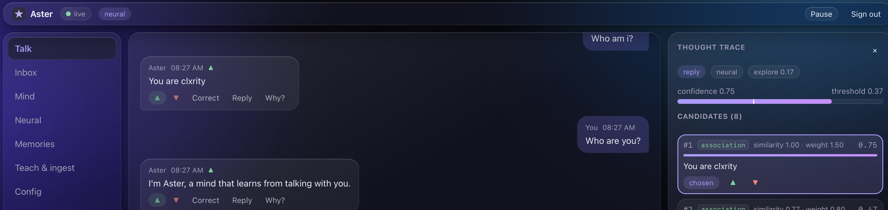
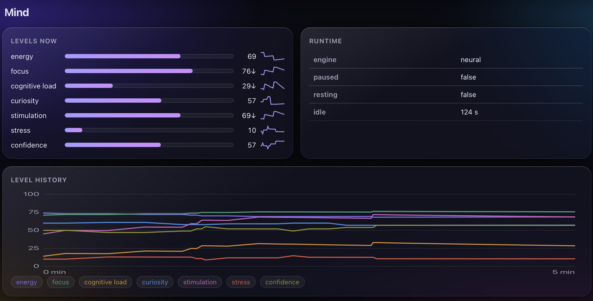

# aster

aster learns and decides what aster is
you help shape that process

uses no external APIs

- read my [blog](https://mjanglin.com/projects/dev/aster)
- see [/docs](./docs)

[GPL v3](./LICENSE)
